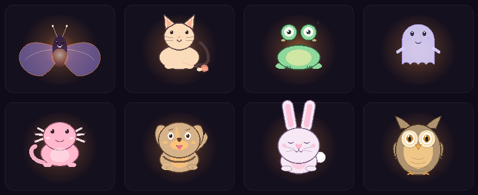
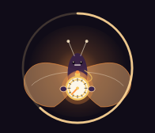
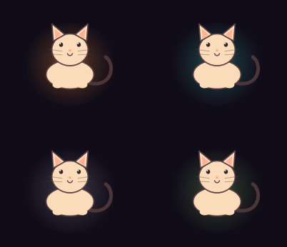

# DeskCompy

**A small companion that lives on your desk, notices your rhythm — never your words — and keeps you company while you work, study, or play.**

[](https://github.com/akhi-mohammmed-o7/DeskCompy/actions/workflows/ci.yml)
[](LICENSE)




Eight hand-drawn buddies — **Lumen** the lantern moth, **Mochi** the loaf cat,
**Pip** the pocket frog, **Wisp** the desk ghost, **Nori** the axolotl,
**Rex** the dog, **Pipkin** the bunny, and **Hoot** the owl. They breathe,
blink, groom, splash, and occasionally show off, all in a frameless little
window that sits above your desktop.

DeskCompy is local-only by design: no account, no network calls, no telemetry,
and no reading of what you type.

## Features

**A companion that reacts**
- Activity is inferred from input *cadence* only — fast typing reads as work,
  steady typing as study, ordinary clicking as work, rapid clicking as gaming,
  and quiet as hanging out. No keys, titles, or screens are read.
- Expressions, captions, glimmer bars, and idle motion follow the rhythm, with
  hysteresis so it does not flicker between moods.
- Each buddy has its own trick idiom: the moth and owl flap, the cat and dog
  groom and wash a paw, the axolotl sits in rippling water, the frog croaks,
  the ghost flickers, the bunny binkies. Tricks run every 30–75 seconds, with
  signature gestures weighted; the smaller motions loop continuously.
- Pin an activity when the guess is wrong; auto-detection resumes when asked.

**Focus that leaves a trace**
- A 5–60 minute focus timer (quick lengths or custom) with a serious pose, an
  intensity ring, and a sweeping pocket watch. Optional desk dimming follows
  the timer, plus "Go again" to repeat.
- Finished sessions build **daily streaks** (consecutive days with at least one
  session; yesterday still counts until today ends) and unlock wardrobe pieces.
- **Exclusive streak set:** Ember circlet at 3 days, Streak medal at 7,
  Constellation cape at 14.
- **Session log** (Focus ▸ Session log…) shows the last seven days with each
  session's time and length, the week's totals, and current/best streak.
- A wardrobe of hats, glasses, neckwear, and capes — most earned through
  minutes or sessions, with requirements shown on each locked row.

**Make it yours**
- Eight coat tints plus natural, and eight glass palettes (amber, tide, ink,
  moss, rose, dusk, frost, ember), switchable from the menu or Customize.
- Nickname, a one-line intention, water reminders, ambient chatter (off by
  default), start-with-Windows, ghost perch (click-through), and mute.
- Drop in your own art or your own buddy: see
  [`assets/PLACE_IMAGES_HERE.txt`](assets/PLACE_IMAGES_HERE.txt).
- Soft synthesised cues (focus tick, wings, grooming, water, croak, flicker,
  binky) generated locally — no audio files to download.

| Focus | Palettes |
| --- | --- |
|  |  |

## Quick start

### Run from source (Windows 10/11)

Requires **Python 3.10+**.

```bash
git clone https://github.com/akhi-mohammmed-o7/DeskCompy.git
cd DeskCompy
python -m venv .venv
.venv\Scripts\activate
pip install -r requirements.txt
python main.py
```

Prefer no console window: double-click **`launch.bat`** (it uses `pythonw`
when available).

### Prebuilt release

Download `DeskCompy-windows.zip` from
[Releases](https://github.com/akhi-mohammmed-o7/DeskCompy/releases), unzip it
anywhere, and run `DeskCompy.exe`. No installer and no admin rights; settings
live in `%APPDATA%\DeskCompy`.

### Build the executable yourself

```bash
pip install pyinstaller
pyinstaller --noconfirm deskcompy.spec
```

Ship the whole `dist/DeskCompy` folder. An `assets` folder placed next to
`DeskCompy.exe` overrides bundled images, so art can be swapped without a
rebuild.

## Using DeskCompy

- **Move it:** left-drag anywhere; it clamps to the screen and snaps to a
  corner when released nearby.
- **Menu:** right-click the buddy (or the tray icon). Activity, buddies, Focus,
  Glass, Customize, Wardrobe, mute, ghost perch, and quit all live there.
- **Talk:** the chat panel uses short, scripted local replies and clears when
  closed. Nothing is stored or sent.
- **Tray:** closing the companion keeps the tray icon available; choose
  "Close Companion" to exit fully.
- **Settings** are saved to `%APPDATA%\DeskCompy\settings.json`; delete the
  file to start fresh. Custom buddies live in the same folder under `buddies`.

## Privacy and safety

- Input hooks record only **that** a key or click happened — never which key.
  Per-second counts stay in memory and die with the process.
- No network code, no telemetry, no update checks, no account.
- Chat replies are static local strings; transcripts are never written.
- Custom buddy files are treated as untrusted: manifests are size-capped,
  paths are constrained to the buddy folder, images are decoded with limits,
  and nothing is executed.
- The optional startup entry is a single per-user `HKCU` value, removable from
  the same dialog.

See [SECURITY.md](SECURITY.md) for the full threat model.

## Troubleshooting

| Problem | Fix |
| --- | --- |
| Nothing appears | Check the tray icon; the window may be hidden behind another app. Use the tray menu to show it. |
| Activity never changes | Global input hooks are Windows-focused. Some security tools block them; add an exception or pin an activity manually. |
| No sounds | "Mute alerts and sounds" may be on. Cues are intentionally quiet; check the system mixer. |
| Custom buddy not listed | Check the slug (`[a-z][a-z0-9_-]{1,23}`), the 32 KB manifest cap, and the `buddy.json` syntax; custom buddies load at startup, so restart after adding one. Logs name the reason. |

## Project layout

| Path | Purpose |
| --- | --- |
| `main.py` | Qt application entry point. |
| `ui_engine.py` | Window, menu, dialogs (customize, wardrobe, focus log), focus flow. |
| `painter.py` | All vector art: bodies, faces, props, accessories, effects. |
| `characters.py` | The eight built-in buddies and custom-buddy installation. |
| `activity.py`, `tracker.py` | Cadence tracking and activity inference. |
| `rituals.py`, `focus_history.py` | Focus timer, session log, streaks. |
| `rewards.py`, `theme.py` | Accessory catalogue/unlock rules, coats and palettes. |
| `chatter.py`, `converse.py` | Local dialogue and keyword replies. |
| `sounds.py`, `chime.py` | Synthesised cues; no audio assets. |
| `settings_store.py`, `paths.py` | Validated persistence and app locations. |
| `custom.py`, `safety.py` | Untrusted custom-buddy loading and text sanitising. |
| `tests/` | 78 unit tests, no display or audio required. |

## Development

```bash
python -m unittest discover -s tests
```

Tests run offscreen with `QT_QPA_PLATFORM=offscreen`. CI covers Python 3.10
and 3.12 on Windows. Contributions are welcome — read
[CONTRIBUTING.md](CONTRIBUTING.md) first.

## License

[MIT](LICENSE). The buddy art is original vector code, so you can fork it,
recolour it, and make it your own.
